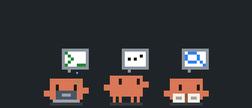

# Polipetto per Claude Code

*[Read in English](README.md)*

Un piccolo polipetto in pixel art che vive nella sidebar di VS Code e mette in scena quello che Claude Code sta facendo davvero.

> Progetto amatoriale non ufficiale. Non è realizzato, approvato o affiliato ad Anthropic.

## Cosa fa

Quando Claude è fermo, il polipetto si rilassa nel suo angolino: respira, sbatte gli occhi, passeggia e alla fine si addormenta.

Quando Claude lavora, l'animazione segue l'attività reale:

| Claude sta... | Il polipetto... | Vignetta |
| --- | --- | --- |
| Eseguendo uno script o un comando | lavora al computer | terminale |
| Eseguendo i test | lavora al computer, poi salta di gioia se passano e trema se falliscono | provetta, poi spunta o croce rossa |
| Compilando o creando un pacchetto | lavora di gran lena al computer | muro di mattoni che cresce |
| Facendo un commit con git | lavora al computer | timbro |
| Facendo push o pull con git | lavora al computer | freccia in su o in giù |
| Installando dipendenze | lavora al computer | pacco che si apre |
| Pubblicando online | lavora al computer, con i coriandoli | razzo |
| Aspettando che Claude Code riprovi dopo un problema di connessione o un limite di utilizzo | si siede e aspetta | clessidra |
| Avendo appena compattato la conversazione | si schiaccia, poi sbuffa e torna normale | compressione |
| Modificando o scrivendo file | lavora al computer | matita |
| Navigando sul web | lavora al computer | globo |
| Usando un altro strumento (MCP e altri) | lavora al computer | ingranaggio |
| Leggendo un file | si mette gli occhiali | pagina di testo |
| Cercando nel codice | si mette gli occhiali | lente |
| Pensando | guarda in alto | puntini o lampadina |
| Delegando a un agente | guarda i suoi agenti | polipetto |
| Pianificando i compiti | guarda in alto | lista |
| Facendoti una domanda | alza la mano | punto interrogativo |
| Trovando un errore | trema | croce rossa |

La vignetta cambia lato a ogni passo, così puoi seguire la sequenza delle azioni.

Ogni agente ha il suo polipetto, e i nuovi nascono da quello che li ha lanciati. Quando un agente finisce festeggia con i coriandoli e poi sparisce, finché ne resta uno a rilassarsi.

## Liste di attività e orchestratori

Accanto a ogni polipetto, una colonna di puntini mostra l'avanzamento reale: grigi da fare, arancioni in corso, verdi completati. Il polipetto la controlla ogni tanto. Usa ciò che è disponibile in quel momento, a partire dal più rilevante:

1. Una lista o un piano ancora aperti: gli strumenti di lista di Claude Code, o il piano dell'app desktop di Claude.
2. Per un agente che ne ha lanciati altri, un puntino per ogni agente lanciato.
3. Una lista già conclusa.

Quando Claude non ha dichiarato i passi in anticipo non c'è un avanzamento da misurare, quindi a ogni passo sale una bolla colorata: blu per la lettura, ambra per le modifiche, viola per l'esecuzione, azzurra per il web, rosa per le deleghe e grigia per gli altri strumenti.

Un agente che ne lancia altri diventa viola, si sposta sopra di loro ed è collegato a loro da linee. Festeggia solo dopo che tutti i suoi agenti hanno finito.

Clicca un polipetto per aprire una nuova sessione di Claude Code in una scheda.

## Requisiti

[Claude Code](https://claude.com/claude-code), come estensione di VS Code o da riga di comando. Per aprire una nuova sessione con un clic serve l'estensione di VS Code.

## Impostazioni

| Impostazione | Predefinito | Descrizione |
| --- | --- | --- |
| `polipetto.scope` | `all` | `all` reagisce a tutte le sessioni su questo computer, `workspace` solo a quelle avviate nelle cartelle aperte in questa finestra. |
| `polipetto.showInExplorer` | `true` | Mostra il polipetto nella barra laterale Esplora. |
| `polipetto.showInSourceControl` | `true` | Mostra il polipetto nella barra laterale Controllo del codice sorgente. |
| `polipetto.showInRunAndDebug` | `false` | Mostra il polipetto nella barra laterale Esegui e debug. |
| `polipetto.showInTesting` | `false` | Mostra il polipetto nella barra laterale Test. |

Per averlo sempre in vista, trascina la sua sezione nella barra laterale secondaria, che non cambia quando passi da una scheda all'altra a sinistra.

## Privacy

L'estensione legge solo i file di sessione che Claude Code tiene sul tuo computer, in `~/.claude/projects` o `CLAUDE_CONFIG_DIR`, per sapere quale strumento è in uso. Non modifica la configurazione di Claude Code, non invia nulla in rete e non raccoglie dati.

## Limiti noti

Claude Code non registra quando aspetta un'autorizzazione, quindi il polipetto continua a lavorare durante quell'attesa. Una sessione muta per 10 minuti torna a riposo.

## Sviluppo

- `npm test` esegue i test.
- `npm run package` crea il file `.vsix`.

## Licenza

[MIT](LICENSE)
