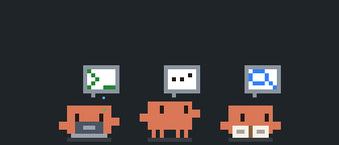

# Polipetto per Claude Code

*[Leggi in italiano](README.it.md)*

A small pixel-art octopus that lives in the VS Code sidebar and acts out what Claude Code is really doing.

> Unofficial fan project. It is not made by, endorsed by, or affiliated with Anthropic.

## What it does

When Claude is idle, the octopus relaxes in its corner: it breathes, blinks, wanders around and eventually falls asleep.

When Claude works, the animation follows the real activity:

| Claude is... | The octopus... | Speech bubble |
| --- | --- | --- |
| Running a script or command | works at the computer | terminal |
| Running tests | works at the computer, then jumps for joy if they pass and shakes if they fail | flask, then check mark or red cross |
| Building or packaging | works hard at the computer | wall of bricks going up |
| Committing with git | works at the computer | stamp |
| Pushing or pulling with git | works at the computer | arrow up or down |
| Installing dependencies | works at the computer | parcel opening |
| Publishing or deploying | works at the computer, with confetti | rocket |
| Waiting for Claude Code to retry after a connection problem or a rate limit | sits and waits | hourglass |
| Having just compacted the conversation | squashes flat, then puffs and pops back | squeeze |
| Editing or writing files | works at the computer | pencil |
| Browsing the web | works at the computer | globe |
| Using another tool (MCP and others) | works at the computer | gear |
| Reading a file | puts on its glasses | page of text |
| Searching the code | puts on its glasses | magnifying glass |
| Thinking | looks up | dots or light bulb |
| Delegating to an agent | looks down at its agents | little octopus |
| Planning its tasks | looks up | checklist |
| Asking you something | raises a hand | question mark |
| Hitting an error | shakes | red cross |

The bubble switches side at every step, so you can follow the sequence of actions.

Every agent gets its own octopus, and new ones split off from the agent that launched them. When an agent finishes it celebrates with confetti, then disappears, until one octopus is left to relax again.

## Task lists and orchestrators

Beside each octopus, a column of dots shows real progress: grey to do, orange in progress, green completed. The octopus checks it now and then. It uses whatever is available at that moment, most relevant first:

1. An open task list or plan: Claude Code's task tools, or the plan of the Claude desktop app.
2. For an agent that launched others, one dot per launched agent.
3. A list that is already finished.

When Claude has not declared its steps in advance, there is nothing to measure progress against, so a coloured bubble rises at each step instead: blue for reading, amber for editing, purple for running, teal for the web, pink for delegating and grey for other tools.

An agent that launches others turns purple, moves above them and is connected to them by lines. It celebrates only after all of its agents have finished.

Click an octopus to start a new Claude Code session in a tab.

## When Claude cannot be reached

The octopus starts switched off: grey and slumped, its plug lying on the floor next to the socket, with a little cloud above it that stands for Claude's server. While the extension checks the connection, the plug tries to reach the socket and a packet heads for the cloud but gets lost halfway. When the server cannot be reached, the dotted line is broken and the cloud shows a red cross.

As soon as Claude's server answers, the plug goes in, the cloud turns orange and the colour rises back into the octopus, which hops awake. If the connection drops later, for example when a VPN disconnects, the plug pops out and the octopus switches off again.

The connection is checked every 30 seconds, and every 10 seconds while the octopus is off. Click the switched-off octopus to check right away. Any answer from the server counts as reachable, even an error.

## Requirements

[Claude Code](https://claude.com/claude-code), as the VS Code extension or the command-line tool. Opening a new session with a click needs the VS Code extension.

## Settings

| Setting | Default | Description |
| --- | --- | --- |
| `polipetto.scope` | `all` | `all` reacts to every session on this computer, `workspace` only to sessions started in the folders open in this window. |
| `polipetto.showInExplorer` | `true` | Show the octopus in the Explorer sidebar. |
| `polipetto.showInSourceControl` | `true` | Show the octopus in the Source Control sidebar. |
| `polipetto.showInRunAndDebug` | `false` | Show the octopus in the Run and Debug sidebar. |
| `polipetto.showInTesting` | `false` | Show the octopus in the Testing sidebar. |
| `polipetto.connectionCheck` | `true` | Switch the octopus off while Claude's server cannot be reached. |
| `polipetto.claudeUrl` | empty | Address of Claude's server to check. When empty, uses `ANTHROPIC_BASE_URL` from the environment or from Claude Code's `settings.json`, otherwise `https://api.anthropic.com`. |

To keep the octopus always in view, drag its section to the Secondary Side Bar, which does not change when you switch tab on the left.

## Privacy

The extension only reads the session files Claude Code keeps on your computer, in `~/.claude/projects` or `CLAUDE_CONFIG_DIR`. It uses them to know which tool is running. To know whether Claude can be reached, it sends an empty `HEAD` request to Claude's server, with no data and no credentials; turn this off with `polipetto.connectionCheck`. It does not change Claude Code's configuration, send anything else over the network, or collect data.

## Known limits

Claude Code does not record when it is waiting for a permission, so the octopus keeps working during that wait. A session that stays silent for 10 minutes goes back to idle.

## Development

- `npm test` runs the tests.
- `npm run package` builds the `.vsix` file.

## License

[MIT](LICENSE)
